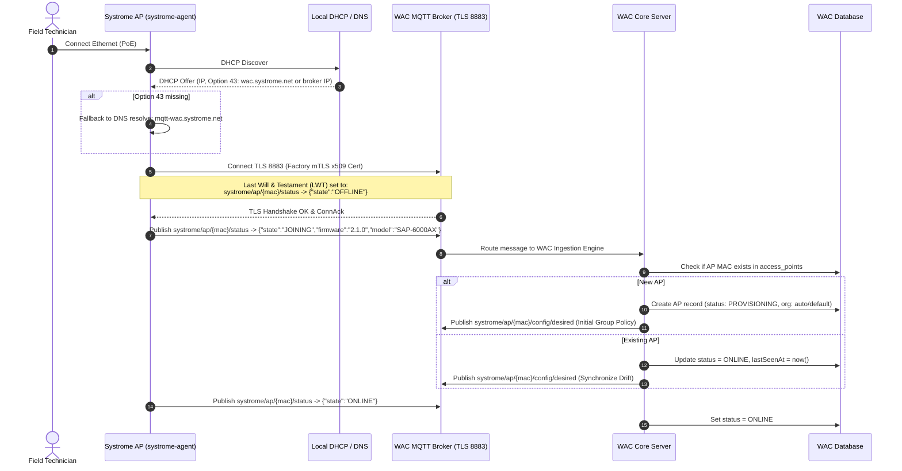
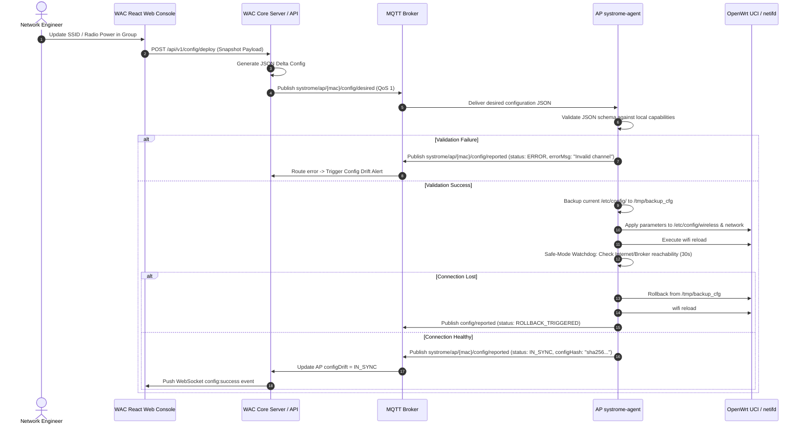

# Systrome Native AP Architecture & Management Specification

**Document Version**: 2.0.0  
**Target Platform**: Systrome Wireless Access Controller (WAC) & Systrome Wireless APs  
**Classification**: Enterprise Technical Architecture & Engineering Specification  

---

## 1. Executive Summary & Strategic Focus

### The "Systrome-First" Strategy
While the Systrome WAC supports heterogeneous multi-vendor infrastructure (Cisco, Aruba, TP-Link Omada, Ubiquiti UniFi, Ruijie), **native Systrome Wireless Access Points are the Tier-1 first-class citizen of the platform**.

By designing a unified, open, and lightweight protocol tailored to Systrome AP hardware (typically running OpenWrt / Systrome OS), we achieve:
1. **Zero-Touch Provisioning (ZTP)**: APs boot from factory, auto-discover the WAC, authenticate via cryptographic certificates, and self-configure without manual engineer intervention.
2. **Sub-Second Real-Time Telemetry & Observability**: Real-time channel utilization, client roaming, RF spectrum noise, and instant offline alerts via **MQTT Pub/Sub**.
3. **Declarative Device-Twin Configuration**: A GitOps-style "Desired State vs. Reported State" engine with transactional validation, safe-mode watchdog, and automatic rollback.
4. **Decoupled Control & Data Planes**: Control and orchestration use lightweight MQTT over TLS, while client data traffic uses either high-speed **Local Bridging (Direct Breakout)** or scalable **VXLAN/WireGuard tunnels** for centralized corporate policies.

---

## 2. Technology Evaluation: SNMP vs. CAPWAP vs. MQTT vs. WebSockets / gRPC

Network engineers frequently evaluate whether to use traditional carrier protocols (**CAPWAP**, **SNMP**) or modern IoT/Edge protocols (**MQTT**, **WebSockets**, **gRPC**) for AP fleet management. Below is an exhaustive engineering comparison:

| Evaluation Dimension | **SNMP (v2c / v3)** | **CAPWAP (RFC 5415/5416)** | **MQTT (v3.1.1 / v5 + TLS)** *(Selected)* | **WebSockets / gRPC** |
| :--- | :--- | :--- | :--- | :--- |
| **Primary Architecture** | Request/Response Polling + Asynchronous Traps | State-machine Client/Server over UDP | Asynchronous Pub/Sub Message Broker | Bidirectional Persistent Point-to-Point Stream |
| **Transport Protocol** | UDP 161 (Poll), UDP 162 (Trap) | UDP 5246 (Control), UDP 5247 (Data) | **TCP 8883 (MQTTS) or TCP 1883** | TCP 443 (HTTP/2 or WSS) |
| **NAT & Firewall Traversal** | ❌ **Extremely Poor**: Controller cannot poll an AP behind a NAT gateway without public IP or VPN. | ⚠️ **Fragile**: UDP stateful firewalls timeout quickly; severe Path MTU (PMTU) & fragmentation drops. | ✅ **Native & Flawless**: AP initiates an outbound TCP TLS session to broker. Works seamlessly behind NAT, CGNAT, 4G/5G WAN. | ✅ **Native**: Standard outbound HTTPS/WSS. |
| **Configuration Delivery** | ❌ **Inadequate**: SNMP `SET` lacks transactional multi-object consistency, schema validation, and rollbacks. | ⚠️ **Complex & Rigid**: Proprietary vendor TLVs; rigid binary byte structures; difficult to extend. | ✅ **Declarative JSON**: Clean JSON payloads applied transactionally to OpenWrt `/etc/config/` via `uci`. | ✅ **Strong**: Protobuf/JSON RPC with typed schemas. |
| **Telemetry & Metrics Latency** | ❌ **High Latency (1–5 min)**: Periodic polling of 1,000 APs overloads controller CPU and network bandwidth. | ⚠️ **Bundled**: Integrated into keepalive packets; inflexible schema changes. | ✅ **Sub-Second Stream**: AP streams radio utilization, client stats, and RF noise floor at customizable intervals. | ✅ **Sub-Second Stream**: High streaming throughput. |
| **Event-Driven Notifications** | ⚠️ **Unreliable Traps**: UDP traps can be lost silently on congested networks. | ⚠️ **Limited**: Standard covers WTP events, but custom telemetry requires vendor TLVs. | ✅ **Guaranteed Delivery**: Configurable QoS (QoS 0 for telemetry, QoS 1 for security alerts, QoS 2 for configs). | ✅ **Reliable**: Stream multiplexing over TCP. |
| **Offline Detection** | ❌ **Slow**: Detects failure only after multiple poll timeouts (3–10 minutes). | ⚠️ **Moderate**: Echo interval timeouts (15–30 seconds). | ✅ **Instant (< 1 sec)**: **Last Will and Testament (LWT)** automatically triggered by broker upon socket disconnect. | ⚠️ **Moderate**: TCP keepalive/ping-pong timeout. |
| **AP RAM & CPU Footprint** | Low (SNMPd daemon). | High (Complex DTLS crypto engine, packet fragmentation buffers). | **Ultra-Low (< 4 MB RAM)**: Minimal C/Go/Python agent footprint; runs on low-cost MIPS/ARM APs. | Moderate to High (gRPC runtime, HTTP/2 multiplexing buffers). |
| **Data Plane Encapsulation** | None (Management only). | Integrated UDP 5247 Split-MAC tunnel. | Decoupled (Pair with **VXLAN / WireGuard / GRE** if centralized tunneling needed). | Decoupled (Management only). |

### Architectural Decision

> **Verdict for Systrome Wireless**:  
> 1. **Control & Monitoring Plane**: **MQTT over TLS (MQTTS)** is the primary protocol. It eliminates NAT traversal issues, provides sub-second event streaming, supports declarative JSON configuration, and consumes almost zero CPU/RAM on Systrome APs.  
> 2. **Data Plane**: Default to **Local VLAN Breakout** (wire-speed switching on AP). For enterprise guest/corporate isolation requiring centralized egress, employ standard **VXLAN / WireGuard** tunnels back to the gateway.  
> 3. **AAA Authentication**: Native **802.1X / RADIUS (FreeRADIUS)** on UDP 1812/1813 directly between AP `hostapd` and the WAC AAA cluster.  
> 4. **SNMP**: Retained as a legacy fallback probe for initial subnet discovery.

---

## 3. End-to-End Systrome AP Lifecycle & Flows

```
 +---------------------------------------------------------------------------------------------------+
 |                                   SYSTROME WAC CONTROLLER PLANE                                  |
 |   +------------------------+    +------------------------+    +-------------------------------+   |
 |   |    Web UI Dashboard    |    |  API & WebSocket Hub   |    |      PostgreSQL 16 Database   |   |
 |   +-----------+------------+    +-----------+------------+    +---------------+---------------+   |
 |               |                             |                                 |                   |
 |               +-----------------------+     |                                 |                   |
 |                                       v     v                                 |                   |
 |                          +----------------------------+                       |                   |
 |                          |   Systrome MQTT Broker     |<----------------------+                   |
 |                          |   (Mosquitto / EMQX TLS)   |                                           |
 |                          +--------------+-------------+                                           |
 +-----------------------------------------|---------------------------------------------------------+
                                           | MQTTS (TCP 8883)
                                           | Outbound Encrypted Session
                                           v
 +---------------------------------------------------------------------------------------------------+
 |                              SYSTROME NATIVE ACCESS POINT (OpenWrt / Linux)                       |
 |                                                                                                   |
 |   +-------------------------------------------------------------------------------------------+   |
 |   |                       systrome-agent (C / Go / Python lightweight daemon)                 |   |
 |   +-------------+-----------------------------+-------------------------------+---------------+   |
 |                 |                             |                               |                   |
 |                 v                             v                               v                   |
 |         +---------------+             +---------------+               +---------------+           |
 |         |  OpenWrt uci  |             |  OpenWrt ubus |               |    hostapd    |           |
 |         | Config System |             | System Bus    |               | 802.11 Engine |           |
 |         +---------------+             +---------------+               +---------------+           |
 |                 |                             |                               |                   |
 |                 v                             v                               v                   |
 |         /etc/config/wireless           iwinfo / netifd                2.4 / 5 / 6 GHz Radios      |
 +---------------------------------------------------------------------------------------------------+
```

---

### Flow 1: Zero-Touch Provisioning (ZTP) & AP Registration

When a brand-new Systrome AP is plugged into a switch port at a remote branch or campus:



---

### Flow 2: Declarative Configuration & Device Twin Engine

Systrome WAC uses a **Device Twin model** (`desired` vs. `reported` state). The controller never blindly sends imperative bash commands. Instead:



---

### Flow 3: Real-Time Telemetry & Event Ingestion

Telemetry is split into **periodic metrics** (gauges) and **instant event triggers**:

```
Periodic Telemetry (every 30s)              Instant Event Triggers (Immediate)
├── CPU, RAM, Flash, Temp                   ├── Client 802.11 Association / Disassociation
├── Radio Channel Utilization (%)            ├── 802.11k/v/r Fast Roam Events
├── Noise Floor (dBm) per band               ├── Radar / DFS Detection (5 GHz Channel Jump)
├── Connected Client RSSI & TX/RX Rates      ├── Rogue AP / Evil Twin SSID Detected
└── Packet Drop & Frame Retry Ratios         └── High Interference / Jamming Alarm
```

---

### Flow 4: Dynamic Radio Resource Management (Auto-RF / RRM)

Instead of forcing engineers to manually assign channels and power to dozens of APs:
1. Every Systrome AP periodically scans neighbor BSSIDs and noise floors during off-channel background scanning (802.11k).
2. The AP publishes neighbor reports to `systrome/ap/{mac}/rrm/neighbors`.
3. The WAC **RRM Algorithm Engine** computes the global RF graph:
   - **Dynamic Channel Assignment (DCA)**: Assigns non-overlapping 20/40/80 MHz channels to eliminate co-channel interference.
   - **Transmit Power Control (TPC)**: Adjusts AP dBm power levels to eliminate coverage holes while avoiding cell overlap.
4. Optimized RF parameters are pushed dynamically via `systrome/ap/{mac}/config/desired`.

---

### Flow 5: Dual-Bank Safe Firmware Over-The-Air (FOTA) Updates

To eliminate the risk of bricking APs at remote branches during firmware updates:
1. Systrome APs utilize **Dual-Bank A/B flash partitions** (Kernel A + RootFS A, Kernel B + RootFS B).
2. WAC issues firmware upgrade RPC with signed URL and SHA-256 checksum:
   `systrome/ap/{mac}/rpc/request` -> `{"action": "UPGRADE_FIRMWARE", "url": "https://wac.../sap-v2.2.bin", "sha256": "..."}`.
3. The AP downloads the binary into inactive Bank B, validates the digital signature, writes to Bank B, sets boot counter to `3`, and reboots into Bank B.
4. If Bank B boots successfully and connects to the WAC MQTT broker within 120 seconds, the agent executes `uboot-env set boot_success 1` (committing Bank B).
5. If the agent fails to connect or crashes, hardware watchdog reboots back into the known-good Bank A automatically!

---

## 4. Systrome MQTT Topic & Protocol Specification

### Topic Hierarchy Structure

All topics use the prefix `systrome/` followed by device class and hardware MAC:

```
systrome/
  └── ap/
      └── {mac_address}/                     # e.g., systrome/ap/00:1A:2B:3C:4D:5E/
          ├── status                         # Retained: AP Lifecycle (ONLINE, OFFLINE, JOINING)
          ├── telemetry                      # Periodic: Radios, CPU, RAM, Client summaries
          ├── events                         # Asynchronous: Client joins, roams, radar, rogue APs
          ├── config/
          │   ├── desired                    # Controller -> AP: Target configuration payload
          │   └── reported                   # AP -> Controller: Applied state & config hash
          └── rpc/
              ├── request                    # Controller -> AP: Instant actions (reboot, blink, pcap)
              └── response                   # AP -> Controller: Command execution result
```

---

### Payload 1: Status Topic (`systrome/ap/{mac}/status`)
* **Direction**: AP $\rightarrow$ Broker  
* **QoS**: 1 (Retained)  
* **Last Will**: Configured during initial MQTT connection to set `{"state": "OFFLINE", "reason": "CONNECTION_LOST"}` if socket abruptly drops.

```json
{
  "mac": "00:1A:2B:3C:4D:5E",
  "serialNumber": "SAP-2026-X889",
  "model": "SAP-6000AX",
  "firmwareVersion": "v2.1.4-systrome",
  "ipAddress": "192.168.1.150",
  "state": "ONLINE",
  "uptimeSeconds": 86420,
  "bootBank": "BANK_A",
  "timestamp": "2026-11-20T10:30:00Z"
}
```

---

### Payload 2: Telemetry Topic (`systrome/ap/{mac}/telemetry`)
* **Direction**: AP $\rightarrow$ Broker  
* **QoS**: 0  
* **Frequency**: Default every 30 seconds  

```json
{
  "mac": "00:1A:2B:3C:4D:5E",
  "system": {
    "cpuUsagePercent": 14.5,
    "memoryUsagePercent": 42.1,
    "temperatureCelsius": 48.0,
    "freeFlashBytes": 84213760
  },
  "radios": [
    {
      "radioIndex": 0,
      "band": "BAND_2_4GHZ",
      "channel": 6,
      "channelWidth": 20,
      "txPowerDbm": 18,
      "utilizationPercent": 34.0,
      "noiseFloorDbm": -94,
      "clientCount": 18,
      "txBytes": 104857600,
      "rxBytes": 482104000
    },
    {
      "radioIndex": 1,
      "band": "BAND_5GHZ",
      "channel": 36,
      "channelWidth": 80,
      "txPowerDbm": 22,
      "utilizationPercent": 18.5,
      "noiseFloorDbm": -98,
      "clientCount": 42,
      "txBytes": 892340000,
      "rxBytes": 2490120000
    }
  ],
  "clients": [
    {
      "mac": "F4:F5:DB:11:22:33",
      "ip": "10.10.100.45",
      "ssid": "Systrome-Corp-Secure",
      "radioBand": "BAND_5GHZ",
      "channel": 36,
      "rssiDbm": -58,
      "snrDb": 40,
      "rxRateMbps": 866.7,
      "txRateMbps": 866.7,
      "uptimeSeconds": 3600
    }
  ],
  "timestamp": "2026-11-20T10:30:30Z"
}
```

---

### Payload 3: Desired Configuration (`systrome/ap/{mac}/config/desired`)
* **Direction**: WAC Controller $\rightarrow$ AP  
* **QoS**: 1 (Persistent until acknowledged)  

```json
{
  "configVersion": 42,
  "configHash": "e3b0c44298fc1c149afbf4c8996fb92427ae41e4649b934ca495991b7852b855",
  "radios": [
    {
      "radioIndex": 0,
      "enabled": true,
      "channel": 1,
      "channelWidth": 20,
      "txPowerDbm": 16
    },
    {
      "radioIndex": 1,
      "enabled": true,
      "channel": 44,
      "channelWidth": 80,
      "txPowerDbm": 20
    }
  ],
  "ssids": [
    {
      "name": "Systrome-Corporate",
      "enabled": true,
      "hidden": false,
      "security": "WPA2_ENTERPRISE",
      "vlanId": 100,
      "clientIsolation": false,
      "bandSteering": true,
      "radius": {
        "primaryIp": "10.10.1.10",
        "port": 1812,
        "secret": "RadiusSecretKey123"
      }
    },
    {
      "name": "Systrome-Guest",
      "enabled": true,
      "hidden": false,
      "security": "WPA2_PERSONAL",
      "passphrase": "WelcomeGuest2026!",
      "vlanId": 200,
      "clientIsolation": true,
      "rateLimitDownKbps": 10000,
      "rateLimitUpKbps": 5000
    }
  ]
}
```

---

### Payload 4: Reported Configuration (`systrome/ap/{mac}/config/reported`)
* **Direction**: AP $\rightarrow$ WAC Controller  
* **QoS**: 1  

```json
{
  "mac": "00:1A:2B:3C:4D:5E",
  "appliedVersion": 42,
  "configHash": "e3b0c44298fc1c149afbf4c8996fb92427ae41e4649b934ca495991b7852b855",
  "status": "IN_SYNC",
  "appliedAt": "2026-11-20T10:31:05Z",
  "error": null
}
```

---

### Payload 5: RPC Actions & Commands (`systrome/ap/{mac}/rpc/request`)
* **Direction**: Controller $\rightarrow$ AP  
* **QoS**: 2 (Exactly once execution)  

```json
{
  "rpcId": "rpc-9821-ab44",
  "action": "REBOOT_AP",
  "parameters": {
    "delaySeconds": 5,
    "reason": "Administrative scheduled maintenance"
  }
}
```

**Actions supported via RPC**:
- `REBOOT_AP`: Graceful restart.
- `LOCATE_BEACON`: Flash front-panel LED (helps field technicians physically locate the AP).
- `RUN_PACKET_CAPTURE`: Stream pcap of `wlan0` over SSH or upload to WAC S3/bucket.
- `TRIGGER_SPEEDTEST`: Run iperf3 / bandwidth test to gateway.
- `DISCONNECT_CLIENT`: Deauthenticate specific client MAC.
- `UPGRADE_FIRMWARE`: Download and burn new image to inactive flash bank.

---

## 5. Systrome AP Firmware Agent (`systrome-agent`)

The Systrome AP agent is an ultra-lightweight binary installed directly into the firmware image (OpenWrt package `systrome-agent`):

### Key Responsibilities of `systrome-agent`:
1. **MQTT Session Daemon**: Maintains a TLS session with automatic backoff reconnection (`1s, 2s, 4s... max 60s`).
2. **OpenWrt Bridge**:
   - Queries `ubus call iwinfo info` to fetch real-time RSSI, channel, and noise floor.
   - Queries `ubus call hostapd.<interface> get_clients` for live connected client telemetry.
   - Translates desired configuration into `uci set wireless.@wifi-iface[...]` and commits with `uci commit`.
3. **Safe-Mode Watchdog**: Spawns an ephemeral timer after any config reload. If the AP loses IP reachability, it rolls back `uci` automatically within 45 seconds.
4. **Procd Service Integration**: Managed by OpenWrt's init system `procd` with automatic respawn on crash.

---

## 6. Feature Matrix: Current State vs. What to Build Next

| Feature Domain | Feature Name | Status in Current WAC Codebase | Next Step to Build for Systrome APs |
| :--- | :--- | :---: | :--- |
| **Fleet Inventory** | Multi-vendor AP Inventory Table | ✅ **Ready** ([AccessPointsPage.tsx](file:///home/thetypo36/Documents/antigravity/friendly-babbage/apps/web/src/pages/AccessPointsPage.tsx)) | Add "Systrome Native" badges, hardware model icons, and direct MQTT status indicator. |
| **Identity & Tenancy** | Multi-Tenancy (Org, Site, Building, Floor) | ✅ **Ready** (`schema.prisma`, `seed.ts`) | Associate Systrome APs to specific Sites/Floors automatically during ZTP based on MAC OUI. |
| **AAA / RADIUS** | 802.1X, MAB, FreeRADIUS PostgreSQL Driver | ✅ **Ready** ([RadiusAaaPage.tsx](file:///home/thetypo36/Documents/antigravity/friendly-babbage/apps/web/src/pages/RadiusAaaPage.tsx), Docker FreeRADIUS) | Pre-configure Systrome AP SSIDs to point default 802.1X radius client to WAC internal FreeRADIUS container. |
| **SSID Management** | WPA2/WPA3 Personal/Enterprise, VLAN Tags | ✅ **Ready** ([WirelessSsidsPage.tsx](file:///home/thetypo36/Documents/antigravity/friendly-babbage/apps/web/src/pages/WirelessSsidsPage.tsx)) | Generate OpenWrt UCI JSON payloads from the SSID forms. |
| **Config Engine** | Policy jobs, dry-run validation, deployment | ✅ **Ready** ([ConfigEnginePage.tsx](file:///home/thetypo36/Documents/antigravity/friendly-babbage/apps/web/src/pages/ConfigEnginePage.tsx)) | Connect deployment execution to publish to `systrome/ap/{mac}/config/desired`. |
| **Spectrum & RF** | Channel utilization charts, active alerts | ✅ **Ready** ([MonitoringRfPage.tsx](file:///home/thetypo36/Documents/antigravity/friendly-babbage/apps/web/src/pages/MonitoringRfPage.tsx)) | Ingest live RF noise floor and co-channel interference stream from `systrome/ap/+/telemetry`. |
| **Messaging Broker** | MQTT Broker Container & TLS Listener | 🟡 **Planned** (Mosquitto cached locally) | Add `mosquitto` service to `docker-compose.yml` with port 1883/8883 and mutual TLS. |
| **Ingestion Worker** | Backend MQTT Subscriber & DB Sync Worker | 🟡 **Planned** (To build in `apps/server`) | Implement `mqtt.worker.ts` in Express server using `mqtt` npm package to process telemetry. |
| **AP Agent Daemon** | OpenWrt / Linux `systrome-agent` | 🟡 **Planned** (Firmware Component) | Build the lightweight agent script/binary for Systrome AP firmware. |
| **FOTA Firmware** | Dual-Bank A/B Firmware Manager | 🟡 **Planned** (Schema has `FirmwareImage`) | Build Firmware Upload & OTA roll-out view in Web UI. |
| **Live Diagnostics** | Remote Web Terminal & Packet Capture | 🟡 **Planned** | Web-based pcap download and remote ping/traceroute trigger via MQTT RPC. |

---

## 7. Implementation Blueprint for the WAC Monorepo

To implement this full flow directly in our existing codebase:

### Step 1: Add Mosquitto Service to `docker-compose.yml`
Add the lightweight Eclipse Mosquitto broker container with persistence and TLS listener on port `8883` and internal port `1883`.

### Step 2: Implement MQTT Telemetry Ingestion Worker in `apps/server`
Create `apps/server/src/workers/mqtt.worker.ts`:
- Connects to `mqtt://redis:1883` or `mqtt://mqtt-broker:1883`.
- Subscribes to `systrome/ap/+/status`, `systrome/ap/+/telemetry`, `systrome/ap/+/events`, and `systrome/ap/+/config/reported`.
- Updates `AccessPoint`, `Radio`, and `WirelessClient` in PostgreSQL.
- Broadcasts updates to the frontend via the existing WebSocket Hub (`/ws`).

### Step 3: Implement Configuration Publisher in `config.controller.ts`
When an administrator clicks **Deploy Configuration** in [ConfigEnginePage.tsx](file:///home/thetypo36/Documents/antigravity/friendly-babbage/apps/web/src/pages/ConfigEnginePage.tsx):
- Format the SSID and radio parameters into the Systrome Desired State JSON format.
- Publish to `systrome/ap/{mac}/config/desired` via MQTT.
- Set AP `configDrift = PENDING_DEPLOY` until the AP sends back `config/reported`.

### Step 4: Add Systrome AP Remote Action Modal in Web UI
In [AccessPointsPage.tsx](file:///home/thetypo36/Documents/antigravity/friendly-babbage/apps/web/src/pages/AccessPointsPage.tsx):
- Add buttons for:
  - **Blink LED (Locate)**
  - **Remote Reboot**
  - **Live Ping & Speedtest**
  - **Trigger Channel Scan**
- These invoke the WAC API, which publishes the corresponding RPC payload to `systrome/ap/{mac}/rpc/request`.

---

## 8. Summary

By centering the WAC on **MQTT over TLS + OpenWrt UCI/Ubus** for Systrome APs:
- We solve all **NAT/firewall traversal** issues without needing complex VPNs or public AP IPs.
- We achieve **instant offline detection** via MQTT Last Will and Testament.
- We achieve **sub-second telemetry** without crushing the controller under periodic SNMP poll cycles.
- We maintain a **clean separation** between the Control Plane (MQTT) and the Data Plane (Local Breakout or VXLAN), delivering the fastest, most scalable wireless controller experience on the market.
